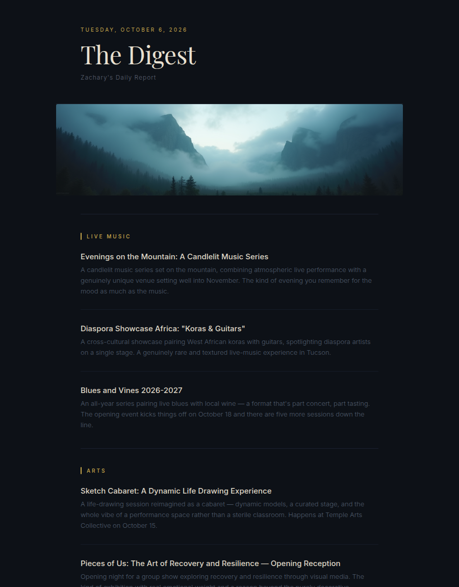

# Morning Report

A self-hosted daily email digest of what's happening around Tucson, written and
illustrated by local models. Every morning n8n wakes a GPU machine, a local LLM
agent reads a set of event pages, a second pass curates the highlights, FLUX
paints a banner, and the result lands in my inbox as a styled HTML email. No
cloud APIs are involved.

<p align="center"></p>

- **Sources:** Eventbrite (music, arts, outdoors and community), Meetup, the
  Loft Cinema, the Rialto Theatre, University of Arizona news and Campus Rec,
  and GitHub projects to explore. They're defined in `sources.js`.
- **Scraping:** `opencode` agents on Ollama fetch each page and return JSON,
  which is validated against a per-source schema and retried on failure.
- **Curation:** a second agent picks and writes up the highlights as HTML.
- **Banner:** Ollama writes an image prompt, and ComfyUI renders it with FLUX.1-dev.
- **Delivery:** n8n wakes the PC over LAN, runs the pipeline over SSH, sends the
  email through the Gmail API, and shuts the machine down. A sanitized export of
  the workflow is in [`n8n/morning_report.json`](n8n/morning_report.json).

The rest of this README covers how it runs and the failure modes it is hardened
against.

## Overview

The pipeline scrapes a handful of sources through the agent wrapper
(`ask_the_agent.ps1`, which drives `opencode` against Ollama), curates the
highlights into a styled HTML email, and prints that HTML to **stdout** so n8n
can pick it up and send it.

## How it fits with n8n

The whole pipeline now lives in this one project. n8n's job shrinks to two steps:

```
[Schedule Trigger] ─▶ [SSH: run.ps1] ─▶ [Send Email]
                            │                 │
                  stdout = finished HTML ─▶  use {{ $json.stdout }}
                                             as the email body
```

- The **SSH** node runs the single entry point on the Windows host:
  `powershell.exe -NoProfile -ExecutionPolicy Bypass -File C:\path\to\morning_report\run.ps1`
- Its `stdout` is the complete, styled HTML document.
- Wire that `stdout` straight into the **Send Email** node's HTML body.
- Give the node a **timeout**. It resolves when the ssh channel closes, which
  needs every writer on the remote stdout to close it — see *Why the run tears
  down its children and exits explicitly* below.

`run.ps1` `cd`s into the project root itself, so the node's working directory
doesn't matter.

All logging goes to **stderr**, so `stdout` is clean HTML with nothing to strip.

## Pipeline

```
sources.js ─┐
            ├─▶ scrape  (retry + JSON validation, per source, concurrent)
            │       │   skip a source after N failed attempts
            │       ▼
            └─▶ merge ─▶ curate (retry + HTML fallback) ─▶ compose email ─▶ stdout / file
```

| Stage        | File                   | Notes                                                              |
|--------------|------------------------|--------------------------------------------------------------------|
| Sources      | `sources.js`           | URLs, prompts, and required JSON keys. Edit this to add/remove.     |
| Agent call   | `src/agent.js`         | Spawns PowerShell → `ask_the_agent.ps1`; prompt via temp file, then stdin. |
| Parse        | `src/parse.js`         | Handles opencode's event stream, plain JSON, ```json fences, prose-wrapped JSON, and NDJSON. |
| Validate     | `src/validate.js`      | Non-empty array of objects, each with every required key.          |
| Scrape       | `src/scrape.js`        | Retry loop; re-prompts "JSON only" on retry; skips source on give-up. |
| Curate       | `src/curate.js`        | Retry loop; falls back to auto-generated HTML if the agent fails.  |
| Compose      | `src/template.js`      | Wraps the body in the dark-theme email shell.                      |
| Orchestrator | `src/index.js`         | Runs the whole thing.                                              |
| Prompts      | `prompts/curation.txt` | Editable curation prompt (`{{RESULTS}}` is substituted).           |
| Config       | `config.js`            | All tunables, read from environment variables.                    |

## Requirements

- **Node.js 18+**
- A Windows host with PowerShell (`powershell.exe`) and **`ask_the_agent.ps1`**.
  The wrapper picks the model and invokes `opencode`; this project just calls
  the wrapper. `config.js` points at the wrapper by **absolute path** rather
  than relying on PATH — see *The wrapper is not really on PATH* below. Override
  with `MR_AGENT_SCRIPT` if the wrapper lives elsewhere.
- **`opencode` on PATH** and a **running Ollama** (`ollama serve`) holding the
  model the chosen mode maps to. Both must be visible to the *n8n service
  account*, not just to an interactive login.

### How the prompt reaches the agent

The prompt is written to a temp file, read back in PowerShell as UTF-8, and
handed to `opencode run` **on stdin**. That last part matters: Windows
PowerShell 5.1 silently strips every unescaped `"` when it builds a native
command line, so passing the prompt as an argument delivers `[{event:a}]` for
`[{"event":"a"}]`. Any prompt carrying JSON — the curation prompt always does —
arrives corrupted. Keep the prompt off the command line.

The wrapper is invoked with `--format json`, so `opencode` returns an NDJSON
event stream instead of a formatted transcript. `src/parse.js` keeps the
`"type":"text"` parts and discards tool traces and session summaries, which the
formatted output offers no reliable way to separate.

### The `digest` agent (`opencode.json`)

The wrapper is also invoked with `--agent digest`, defined in this project's
`opencode.json`. This is not a nicety — it is what makes the pipeline work.

opencode's stock `build` agent is a *coding* assistant, and it answers roughly
half of these prompts with:

> I cannot assist with fetching external event data like music events. My
> purpose is to help with software engineering tasks.

That refusal, not any fetch failure, is what drained the digest: sources were
skipped after three refusals each until no source survived and the email went
out empty. The `digest` agent replaces the coding persona with a research one
and cuts the toolset down to `webfetch`/`websearch` — no `bash`, `edit` or
`write`, which this pipeline has no business using.

`opencode.json` is read from the working directory, and `run.ps1` `cd`s to the
project root, so it applies automatically. Nothing outside the project is
touched.

### Early completion

`runAgent` accepts an `isComplete(textSoFar)` predicate and each caller
supplies one — a JSON array that satisfies the source's `requiredKeys` for
scrapers, a fragment that looks like HTML for curation. The moment the
predicate passes, the process tree is killed and the next source starts.

This is not only a speed optimisation. Left to finish on its own, the agent
keeps going after it has answered: it emits a `## Objective / ## Work State`
session summary, then *repeats* the answer. Concatenating every text part
would splice that summary into the middle of the reply. Stopping at the first
usable answer avoids the problem and roughly halves the wall clock.

`MR_AGENT_TIMEOUT_MS` is therefore only a backstop. The check that actually
catches a stuck agent is `MR_AGENT_IDLE_MS` — the longest allowed *silence*
between events, not total runtime.

### Why the run tears down its children and exits explicitly

`taskkill /T` does not reliably kill `opencode`. It reaps the `powershell.exe`
wrapper, and the `opencode.exe` grandchild routinely survives with its parent
gone — six orphans, one per source, were left behind by a single run.

That matters more than a stray process, because the orphan still holds the
write end of the stdout pipe node handed its shell. A piped stdio stream is a
**ref'd libuv handle**: while one is open the event loop cannot drain, so node
cannot exit — even though `runAgent` resolved long ago and the finished HTML is
already on stdout. The observed failure was a run that produced a complete
`digest-2026-08-14.html` at 07:53 and was still sitting there as a live
`node.exe` at 08:40, with n8n's ssh channel never closing and the execution
never completing.

Three things prevent it, all of which need to stay:

- `runAgent`'s `finish()` removes the stdio listeners and **destroys the pipes**
  instead of merely resolving. Resolving a promise releases nothing.
- `killTree()` runs `taskkill` **synchronously**. Fire-and-forget returned before
  the tree was down, so the next source started while the previous `opencode`
  still held its SQLite session database — the "database is locked" collision
  that burns a source's attempt budget for reasons unrelated to the site.
- `src/index.js` calls `process.exit()` once stdout has flushed, so a handle
  leaked anywhere else can never pin the run again. The flush is what the
  `process.stdout.write(html, cb)` callback waits for — under n8n stdout is a
  pipe and the write is asynchronous, so exiting without it truncates the
  digest mid-document.

If an execution ever hangs again, check the dated file first: a complete
`output/digest-YYYY-MM-DD.html` alongside a still-running `node.exe` means the
work finished and only the exit is stuck. Look for orphans with

```powershell
Get-CimInstance Win32_Process -Filter "Name='opencode.exe' or Name='node.exe'" |
  Select-Object ProcessId, ParentProcessId, CreationDate, CommandLine
```

Set an explicit timeout on the n8n node as well. Even healthy, the worst case is
6 sources × `MR_MAX_ATTEMPTS` × the 10-minute backstop plus curation — roughly
3.5 hours — so a hang should surface as a failed execution rather than one that
runs forever.

## Run

Single entry point (what n8n calls):

```powershell
powershell.exe -NoProfile -ExecutionPolicy Bypass -File run.ps1 > digest.html
```

Or invoke Node directly:

```sh
node src/index.js > digest.html
```

Clean HTML → **stdout**; logs → **stderr**. A dated copy is also written to
`output/digest-YYYY-MM-DD.html` (disable with `MR_WRITE_FILE=false`).

## Error handling & retries

Every agent call is validated and retried:

- **Scrapers** — the reply is parsed for JSON (salvaging fenced or prose-wrapped
  output), then schema-checked against the source's `requiredKeys`. On failure it
  re-prompts with a stricter "return ONLY a JSON array" instruction, up to
  `MR_MAX_ATTEMPTS` (default 3). A source that still fails is **skipped**, and the
  digest is built from whatever succeeded.
- **Curation** — retried until the reply looks like HTML; if it never does, a
  plain HTML listing is generated from the raw results so the email still sends.
- **Total failure** — if *every* source fails, the run still prints a complete
  HTML document whose body says so, and exits non-zero. It never prints nothing:
  an empty stdout is what makes n8n send a blank email, which looks like a mail
  problem rather than a pipeline one. No dated file is written in this case, so
  a failed re-run cannot overwrite a good digest from earlier the same day.
- **Empty agent output** — a wrapper that exits 0 having produced nothing is
  treated as a failed attempt, not an empty answer. A missing `opencode` on the
  service account's PATH and a stopped Ollama both look exactly like this.

### The wrapper is not really on PATH

`ask_the_agent.ps1` runs from any interactive prompt, which makes it look like a
PATH entry. It isn't one. Its directory is absent from both the User and the
Machine PATH in the registry; what puts it there is a line in the interactive
profile:

```powershell
# Microsoft.PowerShell_profile.ps1
$env:Path += ';C:\Users\Zachary\Documents\Agent'
```

Profiles load for interactive sessions. This project spawns PowerShell with
`-NoProfile`, so the spawned shell sees that directory only when the `node`
process it inherited from was itself started from a shell that had loaded the
profile. Run `run.ps1` from your own terminal and it works; run it from the n8n
service account and every source fails with

> The term 'ask_the_agent.ps1' is not recognized as the name of a cmdlet...

and the digest goes out empty. `config.js` therefore defaults to the wrapper's
absolute path. Putting the directory on the *Machine* PATH would fix it too, but
the absolute path keeps the fix inside the project.

To reproduce a service-account environment from your own session, rebuild PATH
from the registry only:

```powershell
$env:PATH = [Environment]::GetEnvironmentVariable("PATH","Machine") + ";" +
            [Environment]::GetEnvironmentVariable("PATH","User")
```

### Keep `MR_CONCURRENCY` at 1

opencode keeps session state in a SQLite database and does not isolate it per
process. Two concurrent `opencode run` invocations contend on it and the loser
exits 1 with:

> Error: Unexpected error — database is locked

The pipeline counts that as a failed attempt and retries, so a source can burn
its whole attempt budget on lock collisions that have nothing to do with the
site being scraped. The old default of `2` made this likely on every run.

### "Could not fetch the page" is usually not a dead URL

`webfetch` is a plain HTTP GET that runs no JavaScript, so two things break a
source without the URL having rotted:

- **JS-only pages.** A page whose listings are rendered client-side arrives as
  an empty shell. `events.trellis.arizona.edu` and the Rialto / Hotel Congress
  calendars are all like this, which is why the sources point at pages that
  carry their listings in the served HTML. Check with `curl` before adding a
  source: if the event links aren't in the raw response, the agent won't see
  them either.
- **Bot protection.** Cloudflare-style filters return `403` with a body reading
  *"Just a moment... Enable JavaScript and cookies to continue"*. `loftcinema.org`
  sits behind one.

As of 2026-08-07 opencode 1.18.11 hardcodes a **Chrome 91** user agent (a 2021
build) for `webfetch`. Verify it before theorising about a block:

```powershell
ask_the_agent.ps1 auto -prompt "use webfetch on https://httpbin.org/user-agent and reply with the exact JSON body" --agent digest
```

**Do not infer the agent's fetch result from `curl` or `Invoke-WebRequest`.**
Bot filters fingerprint the TLS handshake and source IP, not just the user
agent, so the same URL and UA can give three different answers: `loftcinema.org`
returns 403 to PowerShell (schannel) on the agent host yet serves the real page
to opencode's own fetch (Bun/BoringSSL) on that same host. The only test that
settles it is `webfetch` itself, via the command above.

If one source fails while the others succeed, suspect that site. If *every*
source fails at once, suspect `webfetch` itself, the service account's network
access, or a model that is not calling tools at all.

## Adding or changing a source

Edit `sources.js` only. Each entry:

```js
{
  label: "Live Music",                     // category heading in the digest
  prompt: "please use the web fetch tool to look at <url> ... array of JSON ...",
  requiredKeys: ["event", "date", "url"],  // schema every item must satisfy
}
```

## Configuration

All via environment variables (see `config.js`):

| Variable              | Default             | Meaning                              |
|-----------------------|---------------------|--------------------------------------|
| `MR_MAX_ATTEMPTS`     | `3`                 | Retries per agent call               |
| `MR_BACKOFF_MS`       | `2000`              | Linear backoff base between retries  |
| `MR_CONCURRENCY`      | `1`                 | Sources scraped in parallel — see below, leave at 1 |
| `MR_AGENT_TIMEOUT_MS` | `600000`            | Per-agent backstop ceiling (10 min)  |
| `MR_AGENT_IDLE_MS`    | `240000`            | Max silence between events (4 min)   |
| `MR_SHELL`            | `powershell.exe`    | Shell used to invoke the agent       |
| `MR_AGENT_SCRIPT`     | *(absolute path to `ask_the_agent.ps1`)* | Agent wrapper script — absolute on purpose, see below |
| `MR_AGENT_MODE`       | `local`             | Model — `local`, `cloud`, or `auto` (the wrapper's `-mode`) |
| `MR_AGENT_ARGS`       | `--format json`     | Extra args forwarded to `opencode`   |
| `MR_DEBUG`            | `false`             | Log truncated raw replies to stderr  |
| `MR_WRITE_FILE`       | `true`              | Also save a dated HTML file          |
| `MR_OUTPUT_DIR`       | `./output`          | Where dated files go                 |
| `MR_TITLE` / `MR_SUBTITLE` / `MR_FOOTER` | —        | Email header/footer text             |
| `MR_BANNER`           | `true`              | `false` skips the ComfyUI banner     |
| `MR_BANNER_BUDGET_MS` | `480000`            | Cap on the whole banner stage (8 min) |
| `MR_BANNER_MODEL`     | `qwen3:8b`          | Ollama model that writes the image prompt |
| `MR_OLLAMA_HOST` / `MR_COMFYUI_HOST` | `http://127.0.0.1:11434` / `:8188` | Banner endpoints |

### Banner

`src/banner.js` renders a 1216×320 FLUX banner **before** the scrapers start.
It used to run in parallel and never once made it into an email:

- The digest starts ~60 s after WOL, before ComfyUI is listening, so the first
  request died with `fetch failed`. The stage now polls `/system_stats` first.
- FLUX (~16 GB) and the scrapers' 27B model (~21 GB) cannot share the card.
  The prompt model is evicted with `keep_alive: 0` and ComfyUI is told to
  `/free` after the render.
- **Gmail does not display `data:` images.** The n8n workflow has to lift the
  data URI into an inline `cid:` MIME part — see `n8n/` for the nodes.

Smoke test on the Windows box: `node test_banner.mjs` writes `output/banner-test.png`.

### Agent mode

`config.js` exports an `AGENT_MODE` constant (`AUTO` / `LOCAL` / `CLOUD`). To
switch the project **permanently**, change the one line
`const DEFAULT_AGENT_MODE = ...`. To switch **per run**, set
`MR_AGENT_MODE=local` (case-insensitive) — no code change. An unrecognized
value fails fast at startup.

Each mode maps to a model in `ask_the_agent.ps1`. Local models must be declared
in `~/.config/opencode/opencode.json` on the agent host; cloud models resolve
through opencode's own provider registry and need no entry there.

| Mode    | Model                       | Status on the current host (2026-08-07) |
|---------|-----------------------------|------------------------------------------|
| `local` | `ollama/qwen3.6-64k`        | **Works, and is the default.** Declared with `limit.context` 65536, matching the model's `num_ctx`. Verified calling `webfetch` and returning real URLs. Runs on the host GPU, so it costs nothing per run |
| `cloud` | `ollama-cloud/gpt-oss:120b` | **Works.** The strongest of the three and also fetches correctly, but the slowest — it fans out into sub-agent searches and one source can exceed the 10-minute backstop. Needs no block in `opencode.json`, only `OLLAMA_API_KEY`, which is set |
| `auto`  | `ollama/qwen3:30b-a3b`      | Resolves, but **fabricates** — see below  |

A model resolves only if it is declared under `provider.ollama.models` in
`~/.config/opencode/opencode.json`. Pulling it in Ollama is *not* enough:
`qwen3.6-96k` is pulled and was what `local` pointed at, but was never declared,
so the mode could not run. `local` now points at `qwen3.6-64k`, which is both
pulled and declared. Declaring `qwen3.6-96k` (context 98304) would make the
larger window usable too.

**Not every model actually fetches, and the ones that don't fail silently.**
`qwen3:30b-a3b` (`auto`) answers scrape prompts from memory rather than calling
`webfetch`, inventing plausible events with URLs that 404
(`eventbrite.com/e/...-2134567890`, `loftcinema.org/movies/dune-part-two` — the
Loft's real path is `/film/`). Because `validate.js` only checks that each item
is an object carrying `event`/`date`/`url`, invented data passes cleanly and the
digest looks healthy while being wrong. Nothing downstream catches it.

`local` and `cloud` were both checked against the same prompt and both called
`webfetch` and returned live URLs that resolve. Use one of those — `local` is
the default because it fetches correctly without the cloud round trip. If you
point a mode at a new model, verify it the same way before trusting a digest:

```powershell
ask_the_agent.ps1 local -prompt "use the webfetch tool on https://loftcinema.org and return ONLY a JSON array of the FIRST 3 films you see, each with keys event, date, url. The url must be the real loftcinema.org link taken from the page." --agent digest
```

Then check the URLs actually resolve. A model that fabricates will emit tidy,
schema-valid JSON full of 404s.

`OLLAMA_API_KEY` is what authorises `cloud`. opencode reads it from the
environment (`opencode auth list` shows it under *Environment*), and it is
currently set at **User** scope — visible to the interactive user only. If n8n
ever runs as a different account, move it to Machine scope or the mode will
fail there while working by hand, the same trap as the wrapper's PATH above.

## Project layout

```
morning_report/
├── run.ps1              # single entry point → prints HTML to stdout
├── opencode.json        # defines the `digest` agent the scrapers run as
├── config.js            # env-driven configuration
├── sources.js           # the sources to scrape
├── prompts/
│   └── curation.txt      # curation prompt (editable)
├── src/
│   ├── index.js         # orchestrator (entry point)
│   ├── agent.js         # invokes ask_the_agent.ps1
│   ├── scrape.js        # per-source retry + validation
│   ├── curate.js        # curation retry + HTML fallback
│   ├── parse.js         # robust JSON / NDJSON extraction
│   ├── validate.js      # schema validation
│   ├── template.js      # styled email shell
│   └── util.js          # logging, sleep, concurrency
└── output/              # dated HTML copies (git-ignored)
```
